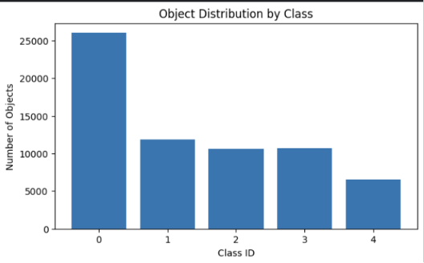

# Road Damage Detection

A comparative object detection project for identifying and localizing road surface damage using YOLOv8 and RT-DETR architectures. This project focuses on model training, custom inference development, independent evaluation, and quantitative performance analysis.

---

## 1. Overview

### Problem Statement

Road damage, including cracks, potholes, and surface deterioration, is a major challenge for road infrastructure maintenance and public safety.

Traditional road inspection relies heavily on manual assessment, which can be time-consuming, resource-intensive, and difficult to scale across large road networks.

This project explores automated road damage detection using deep learning-based object detection models to identify and localize different categories of road damage from images.

### Project Pipeline

The project follows a complete object detection workflow:

1. Dataset exploration and preparation.
2. Training three object detection architectures.
3. Developing a custom inference pipeline.
4. Evaluating predictions using an independently implemented evaluation pipeline.
5. Performing quantitative and qualitative error analysis.
6. Comparing model performance and selecting the preferred architecture.

### Models Trained

| Architecture | Model |
|---|---|
| YOLOv8 | YOLOv8-Small |
| YOLOv8 | YOLOv8-Large |
| RT-DETR | RT-DETR-Large |

### Implementation

- **Training:** Model training using Ultralytics.
- **Inference:** Custom inference pipeline supporting all three trained architectures.
- **Evaluation:** Custom evaluation implementation integrated into my computer vision library.
- **Analysis:** Dataset-level and class-level performance analysis.

### Project Resources

| Resource | Location |
|---|---|
| Training notebook | [`notebooks/yolo-training.ipynb`](./notebooks/yolo-training.ipynb) |
| Source code and evaluation library | [`src/`](./src/) |
| Evaluation notebooks | [`notebooks/`](./notebooks/) |
| Dataset analysis graphs | [`graphs/`](./graphs/) |
| Detailed evaluation report | [`EVALUATION_AND_ANALYSIS.md`](./EVALUATION_AND_ANALYSIS.md) |

---

## 2. Dataset

### Dataset Overview

This project uses the **Road Damage Detection 2022 (RDD2022)** dataset.

The dataset contains road images collected across different geographical environments, providing diverse road conditions and damage patterns for object detection.


### Target Classes

The detection task consists of five road damage categories:

| Class ID | Damage Category | Description |
|---|---|---|
| 0 | Longitudinal Crack | Cracks running parallel to the road direction |
| 1 | Transverse Crack | Cracks running across the road direction |
| 2 | Alligator Crack | Interconnected cracks forming a pattern resembling alligator skin |
| 3 | Other Corruption | Other visible road surface deterioration |
| 4 | Pothole | Depressions or cavities in the road surface |

### Class Distribution

The dataset contains 65,712 annotated objects across five classes.


### Dataset Visualizations

**Object Distribution by Class**

This visualization highlights the distribution of annotated road damage categories and potential class imbalance.



## 3. Model Comparison

Three object detection architectures were trained and evaluated using a common evaluation pipeline.

### Evaluation Methodology

Rather than relying exclusively on framework-reported validation metrics, I implemented an independent evaluation pipeline to assess model predictions consistently.

The evaluation process includes:

- Generating predictions using the custom inference pipeline.
- Applying confidence thresholds for prediction filtering.
- Matching predicted bounding boxes with ground-truth annotations.
- Identifying True Positives (TP), False Positives (FP), and False Negatives (FN).
- Calculating dataset-level and class-level evaluation metrics.


### Overall Dataset Evaluation

The following table compares all three architectures using the same evaluation methodology.


---

## 4. Results Summary

### Model Selection

Based on the comparative evaluation, **YOLOv8-L was selected as the preferred model** for this project.

The selection considers the overall detection performance, balancing precision, recall, F1-score, and bounding box localization quality.


### Comparative Observations

- **YOLOv8-S:** Provides a smaller architecture for comparison against the larger models.
- **YOLOv8-L:** Offers the preferred overall performance based on the project's evaluation.
- **RT-DETR-L:** Provides an alternative transformer-based detection architecture, with different precision-recall trade-offs.

The comparison also highlights the importance of considering false positives and false negatives rather than relying on a single evaluation metric.

For detailed class-wise results, error analysis, and model-specific observations, refer to [`EVALUATION_AND_ANALYSIS.md`](./EVALUATION_AND_ANALYSIS.md).

---

## Repository Structure

```text
Road_damage_object_detection/
│
├── assets/
│   ├── Pothole_low_recall_fn.png
│   ├── YOLO_l_bestcases.png
│   ├── annotationn_onconsistencies.png
│   └── high_fp_model_over_pred.png
│
├── graphs/
│   ├── object_dist_by_class.png
│   └── spatial_heatmap.png
│
├── notebooks/
│   └── Training and evaluation notebooks
│
├── src/
│   └── Custom inference and evaluation pipeline
│
├── README.md
├── YOLOV8L_EVALUATION_AND_ERROR_ANALYSIS.md
└── requirements.txt
```

**Key directories:**
- `assets/` – Visual examples of model predictions, false negatives, false positives, and annotation inconsistencies.
- `graphs/` – Dataset distribution and analysis visualizations.
- `notebooks/` – Model training and experimentation notebooks.
- `src/` – Custom inference and evaluation pipeline implementation.
  


## 6. YOLOv8-L: Evaluation and Error Analysis

YOLOv8-L was selected as the preferred model following comparative evaluation of YOLOv8-S, YOLOv8-L, and RT-DETR-L.

A separate report provides an in-depth analysis of the selected model, including quantitative evaluation, class-wise performance, successful detections, false positives, false negatives, and dataset annotation inconsistencies.

**[Read YOLOv8-L Evaluation and Error Analysis](./YOLOV8L_EVALUATION_AND_ERROR_ANALYSIS.md)**
---

## 7. Future Scope and Improvements

Potential improvements to the current system include:

- **Annotation Refinement:** Investigating ambiguous and inconsistent bounding box annotations.
- **Hard Negative Mining:** Improving robustness against environmental patterns that generate false-positive detections.
- **Test-Time Augmentation:** Exploring augmentation strategies to improve the detection of smaller road damage instances.
- **Model Optimization:** Exploring model compression and inference optimization for resource-constrained deployment.
- **Dataset Generalization:** Evaluating performance on additional road damage datasets and unseen environmental conditions.

---

## 8. Quick Start

### Clone the Repository

```bash
git clone https://github.com/gracyy-rm/Road_damage_object_detection.git

cd Road_damage_object_detection
```

### Create a Virtual Environment

```bash
python -m venv .venv
```

Activate the environment:

**Windows**

```bash
.venv\Scripts\activate
```

**Linux / macOS**

```bash
source .venv/bin/activate
```

### Install Dependencies

```bash
pip install --upgrade pip

pip install -r requirements.txt
```

### Explore the Project

Start with the training and evaluation notebooks to understand the experimental workflow.

```text
notebooks/
```

**Note:** Dataset files and trained model checkpoints may need to be downloaded separately. Refer to the notebook configurations and project documentation for their locations.

---

## Acknowledgements

This project uses the Road Damage Detection 2022 dataset for road damage detection research and experimentation.

