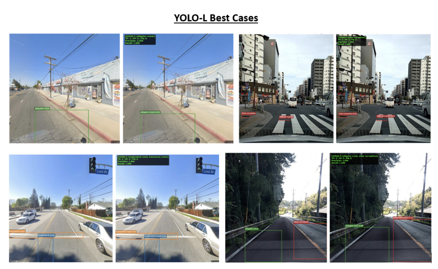
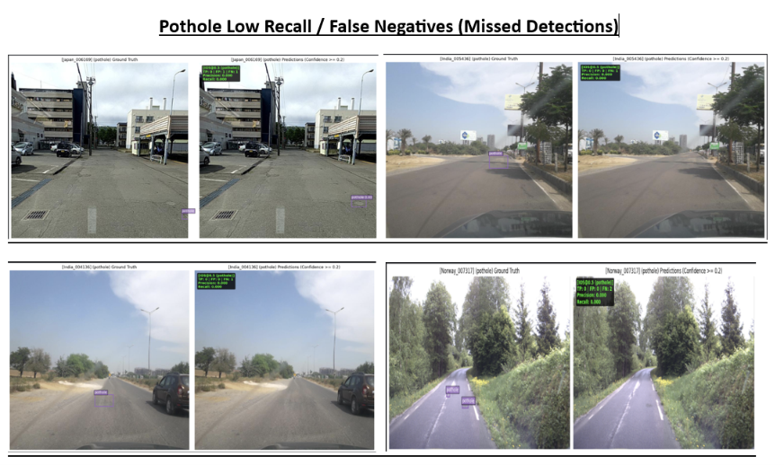
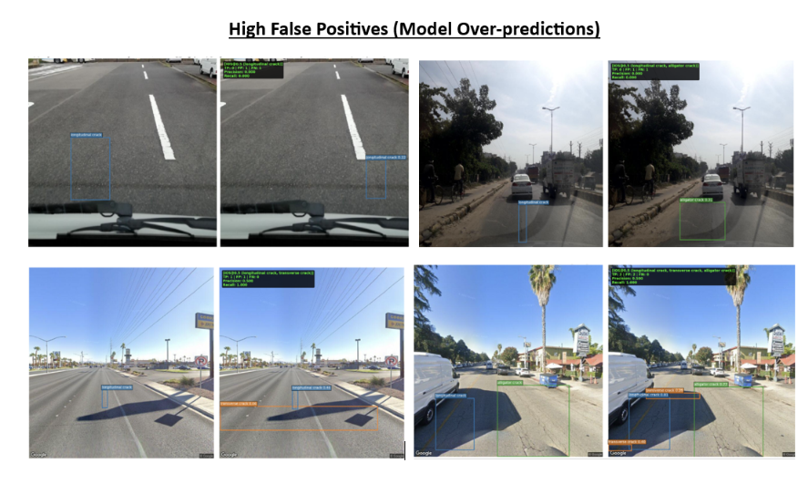
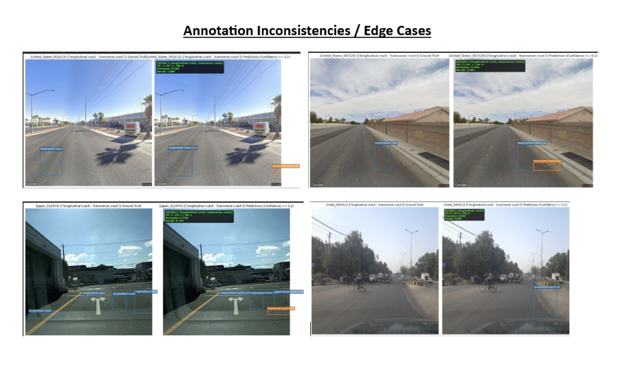

# YOLOv8-L: Evaluation and Error Analysis

This document presents a detailed evaluation of YOLOv8-L, the selected model from the comparative road damage detection experiments. It focuses on quantitative performance, successful detection cases, failure analysis, and limitations observed during evaluation.

The analysis is based on predictions generated through a custom inference pipeline and evaluated using an independently implemented evaluation pipeline.

---

## 1. Selected Model: YOLOv8-L

YOLOv8-L was selected as the preferred architecture after comparing three object detection models:

- YOLOv8-S
- YOLOv8-L
- RT-DETR-L

The selection was based on comparative evaluation of detection performance, considering precision, recall, F1-score, localization quality, and prediction errors.

The objective of this analysis is to understand not only how well the selected model performs but also where it fails and what factors contribute to those failures.

---

## 2. Evaluation Methodology

### Custom Inference Pipeline

A custom inference pipeline was developed to generate predictions from the trained detection models.

The pipeline supports:

- YOLOv8-S
- YOLOv8-L
- RT-DETR-L

Predictions are processed and structured for evaluation against the corresponding ground-truth annotations.

### Custom Evaluation Pipeline

An independent evaluation pipeline was implemented within my custom computer vision library.

The evaluation process includes:

1. Loading ground-truth annotations and model predictions.
2. Filtering predictions using confidence thresholds.
3. Matching predicted bounding boxes with ground-truth boxes.
4. Identifying True Positives, False Positives, and False Negatives.
5. Computing detection and localization metrics.
6. Analyzing performance at dataset and individual class levels.

### Bounding Box Matching: IoS

The evaluation pipeline supports two bounding-box matching approaches:

- **Intersection over Union (IoU):** Measures the intersection area relative to the union of the predicted and ground-truth bounding boxes.
- **Intersection over Smaller area (IoS):** Measures the intersection area relative to the area of the smaller bounding box.

For this experiment, IoS was selected as the matching metric because road damage bounding boxes can have considerable size variations between annotations and predictions.

The IoS metric is calculated as:

Where:
- \(B_p\) represents the predicted bounding box.
- \(B_{gt}\) represents the ground-truth bounding box.
- \(B_p \cap B_{gt}\) represents their intersection area.

Unlike IoU, IoS normalizes the intersection by the smaller bounding-box area. This makes it useful for evaluating overlap when the predicted and ground-truth boxes differ significantly in size.

**Evaluation Configuration:** IoS was used for the reported evaluation results. The evaluation pipeline also supports IoU-based matching as an alternative configuration.

### Evaluation Metrics

| Metric | Description |
|---|---|
| Precision | Proportion of predicted detections that are correct |
| Recall | Proportion of ground-truth objects successfully detected |
| F1-Score | Harmonic mean of precision and recall |
| Mean IoS | Average Intersection over Small for matched detections |
| TP | Correctly matched predictions |
| FP | Predictions that do not match a ground-truth object |
| FN | Ground-truth objects that remain undetected |

The evaluation also considers class-wise performance to identify categories where the model performs relatively well or struggles.

---

## 3. Quantitative Evaluation

### Overall Dataset Performance

The following table summarizes the performance of the selected YOLOv8-L model on the test dataset.

### Class-wise Performance

Object detection performance can vary significantly across damage categories because of differences in object appearance, size, frequency, and annotation quality.

**Interpreting the Results**

The reported TP, FP, and FN values are determined using the selected IoS-based matching configuration. Precision, Recall, and F1-score are calculated from these detection counts.

Mean IoS provides an indication of the localization overlap between matched predicted and ground-truth bounding boxes.

---

## 4. Qualitative Analysis

Quantitative metrics provide an overall assessment of model performance, but visual inspection helps identify the underlying reasons behind incorrect predictions.

The following examples illustrate successful detections and important failure cases observed during YOLOv8-L evaluation.

### 4.1 Successful Detection Cases

The selected model successfully identifies and localizes several road damage patterns.

**Observations:**

- The model successfully identifies visible road damage instances.
- Bounding boxes provide localization of detected damage regions.
- These examples demonstrate the model's ability to recognize different road surface deterioration patterns.

These examples represent successful predictions and help demonstrate the practical capabilities of the trained detector.

### 4.2 False Negatives: Pothole Detection

**Observed Issue:**

Some pothole instances remain undetected, resulting in false negatives and reduced recall.

**Possible Contributing Factors:**

- Variations in pothole size and appearance.
- Low visual contrast between potholes and surrounding road surfaces.
- Challenging lighting and environmental conditions.
- Difficult or ambiguous object boundaries.

**Impact:**

Missed pothole detections are particularly important because they reduce the system's ability to identify all relevant road damage instances.

This indicates that pothole detection remains an area for further improvement.

### 4.3 False Positives: Over-Prediction

**Observed Issue:**

The model generates additional detections that do not correspond to the annotated ground-truth objects.

**Possible Contributing Factors:**

- Road textures resembling actual damage patterns.
- Shadows, surface markings, and irregular pavement structures.
- Visually similar patterns across different road damage categories.
- Confidence scores that allow ambiguous predictions to pass the filtering threshold.

**Impact:**

False positives reduce precision and may introduce unnecessary detections into downstream road inspection workflows.

Reducing these predictions is important for improving the reliability of the detection system.

### 4.4 Dataset Annotation Inconsistencies

**Observed Issue:**

Visual inspection reveals inconsistencies in some ground-truth annotations.

Examples of potential annotation issues include:

- Inconsistent bounding box boundaries.
- Differences in annotation coverage for similar damage patterns.
- Ambiguous object boundaries.
- Potentially inconsistent labeling of visually similar road conditions.

**Impact on Evaluation:**

Annotation inconsistencies can affect the evaluation process.

A visually reasonable prediction may be classified as a false positive or receive a lower localization score when its bounding box does not align sufficiently with the annotated ground truth.

Similarly, incomplete annotations can cause correct detections to be counted as false positives.

This highlights the importance of considering annotation quality when interpreting object detection metrics.

---

## 5. Key Findings

The combined quantitative and qualitative analysis provides several important observations:

1. **Overall model selection:** YOLOv8-L was selected as the preferred model based on the comparative evaluation of all three architectures.
2. **Detection capability:** The model successfully identifies and localizes various road damage patterns.
3. **Pothole recall:** Missed pothole instances indicate scope for improving detection sensitivity.
4. **False-positive predictions:** Environmental patterns and visually similar road textures contribute to incorrect detections.
5. **Annotation quality:** Ground-truth inconsistencies can influence both model evaluation and the interpretation of prediction errors.

These findings demonstrate why model assessment should consider both numerical metrics and visual error analysis.

---

## 6. Limitations

Despite the observed detection capabilities, several limitations remain:

- False-positive detections on challenging road textures.
- Missed detections for certain pothole instances.
- Sensitivity to object appearance, size, and environmental conditions.
- Dependence on the quality and consistency of dataset annotations.
- Potential limitations in generalization to unseen road environments.

The selected model should therefore be considered an experimental road damage detection system rather than a production-validated solution.

---

## 7. Future Improvements

Potential directions for improving the selected model include:

| Area | Proposed Improvement |
|---|---|
| False Positives | Hard negative mining using challenging background samples |
| Pothole Recall | Improved representation of difficult and smaller pothole instances |
| Annotation Quality | Reviewing ambiguous and inconsistent ground-truth annotations |
| Small Object Detection | Exploring test-time augmentation |
| Generalization | Evaluation on additional road damage datasets |
| Deployment | Model optimization and inference efficiency improvements |

---

### Custom Evaluation Implementation

The evaluation pipeline used in this project is implemented using my custom computer vision library, [cv-toolkit](https://github.com/gracyy-rm/cv-toolkit).

The library provides reusable computer vision utilities, including configurable IoU/IoS-based bounding-box matching and object detection evaluation metrics.

This separation allows the project-specific inference pipeline and the reusable evaluation functionality to be maintained independently.

---

## 8. Conclusion

YOLOv8-L was selected as the preferred model after a comparative study involving YOLOv8-S, YOLOv8-L, and RT-DETR-L.

Beyond model training, this project involved developing an independent inference and evaluation workflow to analyze object detection performance at both dataset and class levels.

The qualitative analysis further helped identify successful detection cases, false negatives, false positives, and annotation-related limitations.

Overall, this work demonstrates an end-to-end object detection experimentation workflow, combining model development, custom evaluation, and systematic error analysis for road damage detection.

